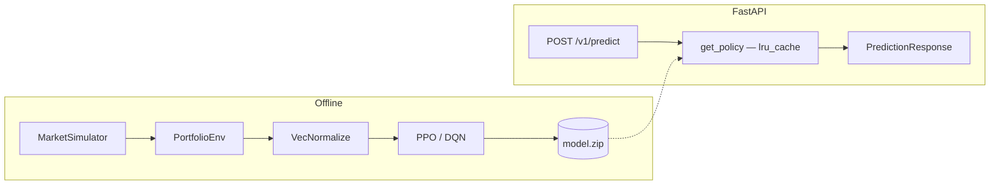

# FinRL Portfolio — RL-Driven Portfolio Allocation

A reinforcement-learning portfolio-allocation service: PPO and DQN agents
(`stable-baselines3`) trained on a simulated, regime-switching market,
backtested on held-out seeds, and served through a FastAPI production
backend.

This is a research/demo system trained on **synthetic market data**, not a
trading system and not financial advice. Every number in this README is
reproducible by re-running the scripts referenced next to it — nothing here
is a target, an estimate, or copied from elsewhere.

---

## What's actually in this repo

- A genuine Gymnasium environment (`finrl.env.portfolio_env.PortfolioEnv`)
  over a regime-switching geometric Brownian motion market simulator
  (`finrl.env.market_simulator`) — a real sequential-decision problem, not
  a stateless per-call scoring function.
- PPO and DQN agents trained with `stable-baselines3`, across two distinct
  reward formulations (`return_minus_drawdown`, `risk_adjusted`).
- A real, documented bug fix: the first trained agents collapsed to always
  picking the same action regardless of state. Root-caused, fixed with
  observation normalization, and verified empirically — see
  [`docs/architecture.md`](docs/architecture.md#the-model-collapse-bug-and-how-it-was-actually-found).
- Backtesting on market seeds disjoint from training — genuine held-out
  evaluation, not train-set performance dressed up as generalization.
- A FastAPI service with Pydantic validation, dependency-injected model
  loading, structured JSON logging, Prometheus metrics, and OpenTelemetry
  tracing hooks.
- A benchmark script (`scripts/run_benchmark.py`) that trains all four
  algorithm × reward-mode combinations and writes a machine-generated
  report — [`eval/results/benchmark_report.md`](eval/results/benchmark_report.md) — including an
  action-distribution column specifically so a future policy collapse
  would show up in the report itself.

## What this repo does **not** claim

- No real market data — the simulator is synthetic and documented as such
  everywhere it's referenced.
- No hyperparameter search — PPO and DQN each use one reasonable,
  equal-effort configuration (`src/finrl/agents/factory.py`).
- No claimed trading return, Sharpe target, or business-impact figure.
  "Stability win rate" in the benchmark report is explicitly defined as the
  fraction of held-out episodes with non-negative return — a specific,
  reproducible definition, not a number chosen to match anything external.

---

## Architecture



Full write-up, including the model-collapse debugging narrative and reward
formulation details, in [`docs/architecture.md`](docs/architecture.md).

---

## Quickstart

```bash
python3 -m venv .venv
source .venv/bin/activate
pip install -e ".[dev]"
```

A trained flagship model (PPO, `return_minus_drawdown`) is committed under
`models/` so the API runs out of the box:

```bash
uvicorn finrl.api.main:app --reload
```

```bash
curl -X POST http://127.0.0.1:8000/v1/predict \
  -H "Content-Type: application/json" \
  -d '{"volatility":0.15,"momentum":0.02,"drawdown":0.05,"cash_ratio":0.3}'
```

```json
{
  "recommended_action": "growth",
  "action_index": 2,
  "policy_scores": [0.0004, 0.2353, 0.7643],
  "algorithm": "ppo",
  "reward_mode": "return_minus_drawdown",
  "disclaimer": "Synthetic-data research demo. Not financial advice."
}
```

### Docker

```bash
docker build -t finrl-portfolio .
docker run -p 8000:8000 finrl-portfolio
```

The image installs the package and copies the committed `models/`
directory — it does not retrain at build time. Verified: `docker build`,
container start, `/healthz`, `/readyz`, `POST /v1/predict`, and the image's
own `HEALTHCHECK` all pass against the built image.

---

## API

| Method | Path | Purpose |
|---|---|---|
| GET | `/healthz` | Liveness — no model access |
| GET | `/readyz` | Readiness — confirms the model loaded |
| POST | `/v1/predict` | Recommended action for a market state |
| GET | `/v1/actions` | Action name → index mapping |
| GET | `/metrics` | Prometheus metrics |
| GET | `/docs` | OpenAPI/Swagger UI (FastAPI default) |

`POST /v1/predict` request body — every field is validated with an
explicit range (replacing the original implementation's unvalidated
`request.get_json(force=True)`):

```json
{
  "volatility": 0.15,
  "momentum": 0.02,
  "drawdown": 0.05,
  "cash_ratio": 0.3
}
```

`policy_scores` is deliberately generic naming: for DQN it's raw per-action
Q-values; for PPO it's the actual action-probability distribution. These
are not interchangeable quantities — see
[`docs/architecture.md`](docs/architecture.md#api-design).

---

## Training and evaluation

```bash
python scripts/train.py --algorithm ppo --reward-mode return_minus_drawdown --timesteps 100000
python scripts/run_benchmark.py --timesteps 100000 --eval-episodes 30
```

`run_benchmark.py` trains all four algorithm × reward-mode combinations,
backtests each on 30 held-out market seeds (disjoint from the training
seed), and writes both a raw JSON and a rendered markdown report to
`eval/results/`. The current committed report, from an actual 100k-timestep
run:

| Algorithm | Reward mode | Mean cumulative return | Std | Mean max drawdown | Mean Sharpe | Stability win rate | Action distribution (def./bal./growth) |
|---|---|---|---|---|---|---|---|
| PPO | return_minus_drawdown | 0.0041 | 0.0341 | 0.0347 | 0.603 | 70.0% | 87% / 3% / 10% |
| PPO | risk_adjusted | 0.0058 | 0.0682 | 0.0792 | 0.110 | 46.7% | 2% / 55% / 42% |
| DQN | return_minus_drawdown | 0.0052 | 0.0451 | 0.0552 | 0.203 | 53.3% | 19% / 79% / 2% |
| DQN | risk_adjusted | 0.0036 | 0.0170 | 0.0223 | 0.461 | 56.7% | 96% / 2% / 1% |

Full table with train time and metric definitions:
[`eval/results/benchmark_report.md`](eval/results/benchmark_report.md).

---

## Testing

```bash
pytest tests/ -v      # 30 tests: environment, metrics, and API (against the real committed model)
ruff check src scripts tests
ruff format --check src scripts tests
mypy src               # strict mode, zero errors
```

CI (`.github/workflows/ci.yml`) runs all of the above plus a Docker build
and a live container smoke test on every push and PR to `main`.

---

## Project structure

```text
src/finrl/
├── env/               # MarketSimulator, PortfolioEnv (Gymnasium)
├── agents/             # PPO/DQN factory (stable-baselines3)
├── evaluation/          # metrics, backtest (held-out evaluation)
├── api/                # FastAPI: schemas, dependencies, routes, main
├── config.py            # pydantic-settings (FINRL_ env prefix)
├── logging_config.py    # structlog JSON logging
└── observability.py     # Prometheus + OpenTelemetry wiring
scripts/
├── train.py              # train + save one model
└── run_benchmark.py      # train all 4 combinations, backtest, report
tests/unit/               # environment, metrics, API tests
eval/results/              # benchmark_report.md, benchmark_raw.json
docs/architecture.md        # design rationale + model-collapse writeup
models/                      # committed flagship model (PPO)
```

---

## Known limitations

- Synthetic market data only — see "What this repo does not claim" above.
- No hyperparameter search; PPO/DQN comparison uses one configuration each.
- 60-step episodes, short by RL-benchmark standards, due to time
  constraints rather than a tuned choice.
- Cash is assumed to earn zero return (a stated simplification in
  `PortfolioEnv`, not a hidden one).
- Single-asset allocation (risky asset vs. cash) — no multi-asset
  portfolio construction.

---

## Author

**Vansh Patel**
M.S. Computer Science (AI & ML), Stevens Institute of Technology

GitHub: https://github.com/vanshpatel9669
LinkedIn: https://linkedin.com/in/vanshpatel1702
