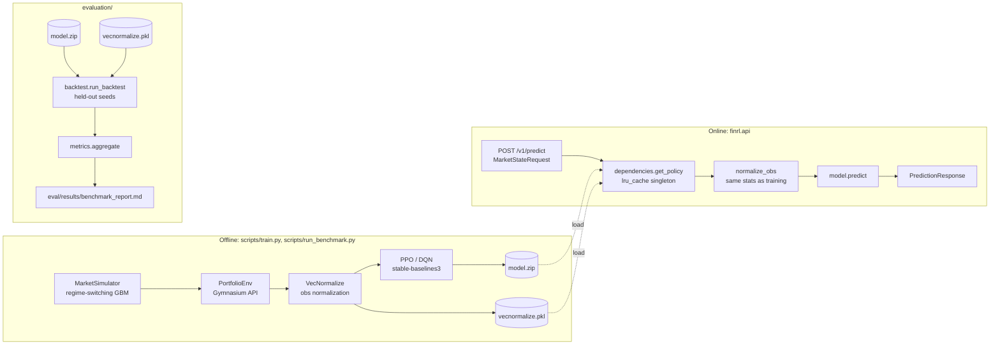

# Architecture

## System overview

## Why a real environment, not a stateless reward lookup

The previous version of this project computed a reward for a single,
independently-sampled feature vector on every call — there was no episode,
no state transition, and no way for an allocation decision to affect what
happened next. That is a contextual-bandit-shaped problem wearing RL
vocabulary, and it does not require (or benefit from) PPO/DQN at all: a
supervised classifier over the same reward function would do exactly as
well.

`finrl.env.market_simulator.MarketSimulator` and
`finrl.env.portfolio_env.PortfolioEnv` replace that with a genuine
sequential-decision problem: price evolves step by step under a
regime-switching geometric Brownian motion (`Regime.CALM_BULL` /
`CHOPPY` / `CRASH`, transitioning via a Markov matrix), and the fraction of
the portfolio exposed to that price process is set by the agent's action at
each step. A DEFENSIVE choice now changes exposure to a CRASH regime that
hasn't happened yet — the decision has consequences the agent has to
learn to anticipate, which is the actual precondition for PPO/DQN to be a
meaningful choice of algorithm rather than a buzzword.

`PortfolioEnv` passes `gymnasium.utils.env_checker.check_env` (see
`tests/unit/test_portfolio_env.py`), which is the standard way to verify an
environment actually conforms to the Gymnasium API stable-baselines3
expects, rather than merely resembling it.

## The model-collapse bug, and how it was actually found

The first trained PPO and DQN agents (40k timesteps, no observation
normalization) converged to a policy that picked the same action on every
step regardless of the input state. This was not obvious from return
numbers alone — a fixed-action policy still produces plausible-looking
cumulative return and Sharpe ratio, because those metrics summarize
portfolio *value*, not policy *behavior*.

It was found by comparing PPO trained under the two different reward
formulations (`return_minus_drawdown` vs. `risk_adjusted`) and noticing the
aggregate metrics came out identical to four decimal places — a coincidence
implausible enough to investigate rather than accept. The investigation,
in order:

1. Verified the two reward modes actually produce different reward
   magnitudes for the same trajectory (`return_minus_drawdown` rewards were
   O(0.01); `risk_adjusted` rewards were O(1-30), since dividing by a small
   volatility denominator amplifies the signal).
2. Verified the two trained models had genuinely different weights
   (`torch.equal` on the policy state dicts returned `False`, with a
   nontrivial max absolute parameter difference) — ruling out "the training
   script silently trained the same model twice."
3. Counted actions taken during backtesting (`collections.Counter`) and
   found both policies always chose `Action.DEFENSIVE` — the policies
   really had collapsed; the identical-metrics observation wasn't a
   measurement artifact.

**Root cause**: the four observation features (volatility, momentum,
drawdown, cash_ratio) have very different natural scales, and were fed to
the policy network unnormalized. A small MLP given noisy, badly-scaled
inputs and a modest training budget settled into a low-variance local
optimum — the safest fixed action — rather than learning a state-dependent
policy.

**Fix**: wrap the environment in `stable_baselines3.common.vec_env.
VecNormalize` with `norm_obs=True, norm_reward=False` (`finrl.agents.
factory.make_vec_env`). Reward is deliberately left un-normalized so
reward magnitudes stay comparable across runs and reward modes; only the
observation scale was the problem. The running normalization statistics
computed during training have to be reused at both backtest time
(`evaluation/backtest.py`) and serve time (`api/dependencies.py`) — a
policy evaluated on raw observations after training on normalized ones is
silently evaluating a different input distribution than the one it
learned.

**Verification, not assumption**: after the fix, the full 4-combination
benchmark was re-run at 100k timesteps and the action distributions
genuinely diverged across algorithm/reward-mode combinations (see
`eval/results/benchmark_report.md`'s action-distribution column — none of
the four runs collapsed to a single action). The benchmark report's action
distribution column was added specifically so a future collapse would show
up in the report itself rather than requiring another ad hoc investigation
to notice.

This is also why `eval/results/benchmark_report.md` always includes an
action-distribution column: it is a deliberate, permanent instrument
against the exact failure mode described above, not a coincidental
addition.

## Reward formulations

Two reward functions are implemented in `PortfolioEnv._compute_reward`,
selectable at training time (`--reward-mode`):

- `return_minus_drawdown`: `portfolio_return - 0.5 * drawdown`. Penalizes
  realized drawdown directly.
- `risk_adjusted`: `portfolio_return / (trailing_volatility + 1e-4)`.
  Penalizes exposure to recent return volatility, independent of whether
  that volatility has yet produced a drawdown.

These are genuinely different optimization targets, not two names for the
same formula — the benchmark report's diverging action distributions across
reward modes for the same algorithm is the empirical evidence for that.

## API design

`finrl/api/` is intentionally thin: `routes.py` contains no model logic,
only request/response wiring; all stable-baselines3-specific code
(model loading, observation normalization, per-action score extraction)
lives in `dependencies.LoadedPolicy`, injected via FastAPI's
`Annotated[..., Depends(...)]` pattern and cached with `functools.
lru_cache` so the model loads once per process, not once per request.

`policy_scores` in `PredictionResponse` is deliberately generic naming: for
DQN it is the network's raw Q-values per action; for PPO it is the actual
action-probability distribution. These are not interchangeable
quantities — a Q-value has no fixed range, while a probability sums to 1 —
and the code comment in `dependencies._per_action_scores` states this
explicitly so the distinction isn't lost the next time this code is read.

## What this project does not claim

- **No real market data.** `MarketSimulator` is synthetic (regime-switching
  GBM). Numbers in the benchmark report describe relative algorithm
  behavior on a controlled simulation, not real-market trading
  performance.
- **No hyperparameter search.** PPO and DQN each use one reasonable,
  equal-effort set of hyperparameters (`agents/factory.py`) — the benchmark
  compares two defaults, not each algorithm's best achievable result.
- **No claimed financial return, Sharpe target, or business impact
  figure.** Every number in `eval/results/` came from an actual run of
  `scripts/run_benchmark.py` and is reproducible by re-running it; none was
  chosen to match an external target.
